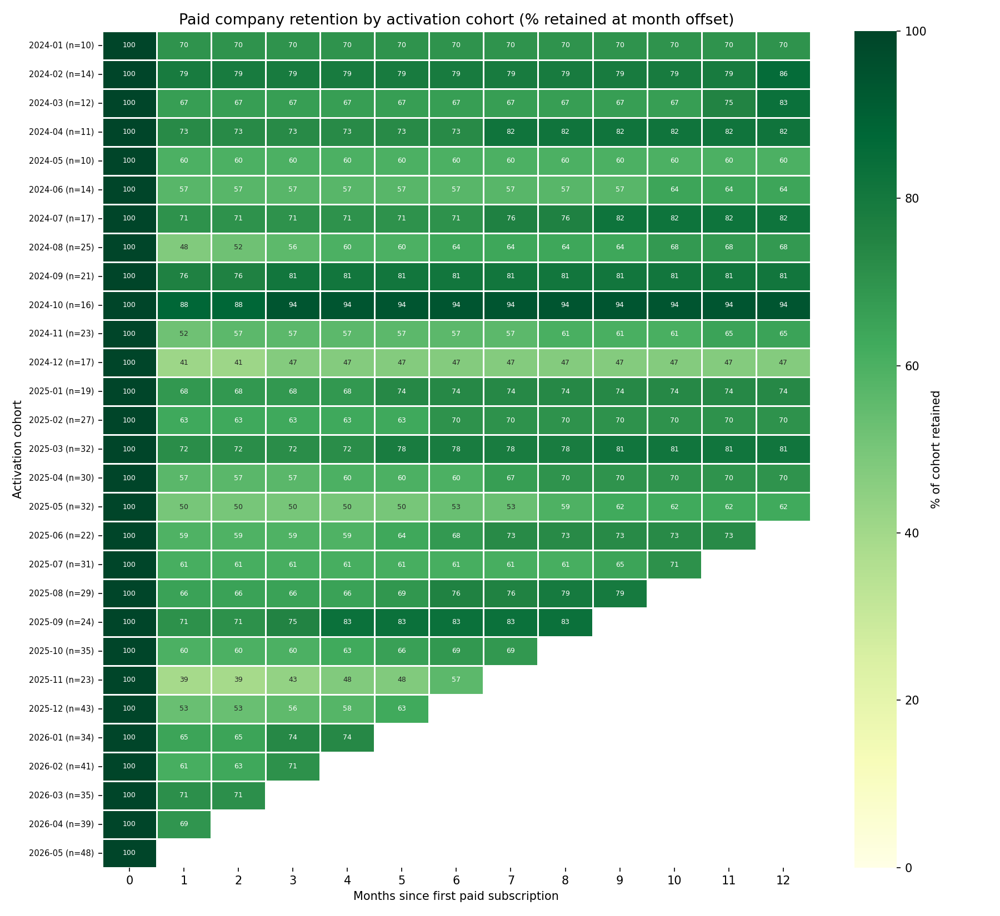

# SaaS Churn & Retention Analysis

By Akshobya698.

SQL + Python analysis of SaaS customer churn and retention by plan, tenure, and engagement. **Current MRR $246,739 · paid churn ~2%/mo · one CS trigger recommended.**

## The one recommendation

Companies that evaluate hard but never invite a teammate churn at **36% vs
~21% baseline**. CS runs the day-30 watchlist now; product redesigns onboarding
next. [Why this one won →](findings/05_synthesis.md) · [The 3-number summary →](findings/00_executive_summary.md)

## How this repo is built: two investigations, one verdict

Most churn analyses run one lens. This one runs two in parallel, then commits
to which finding to escalate — that choice is the deliverable.



- **M2 — Foundation** ([sql](sql/02_foundation.sql) · [brief](findings/02_foundation.md)): definitions of active/churned, MRR by tier, 12-month churn trend. Everything downstream reuses these definitions.
- **M3 — Investigation A: cohort retention** ([sql](sql/03a_cohort_retention.sql) · [notebook](notebooks/03a_cohort_retention.ipynb) · [brief](findings/03a_cohort_retention.md)): activation-cohort heatmap above. Finding: retention is decided in month one (~38% gone by month 2, then flat); the 2026 uptick is broad-based, not one bad cohort.
- **M4 — Investigation B: behavioural predictors** ([notebook](notebooks/04b_predictors.ipynb) · [chart](figures/predictor_comparison.png) · [brief](findings/04b_predictors.md)): churned-vs-retained onboarding comparison. Finding: evaluation without collaboration (dashboard/export, zero invites) predicts 36% churn.
- **M5 — Synthesis** ([brief](findings/05_synthesis.md)): scored on effect size, ease of action, org fit, and feedback speed — M4 escalated first, M3 funded as the longer bet.

## Reproduce

Read-only Postgres (Neon). Nothing to install beyond Python deps:

```bash
pip install -r requirements.txt
export SAAS_DSN='<read-only DSN>'
# SQL: run sql/*.sql in SQLTools (SET search_path TO saas; is included)
# Notebooks: run top-to-bottom; figures regenerate into figures/
```
