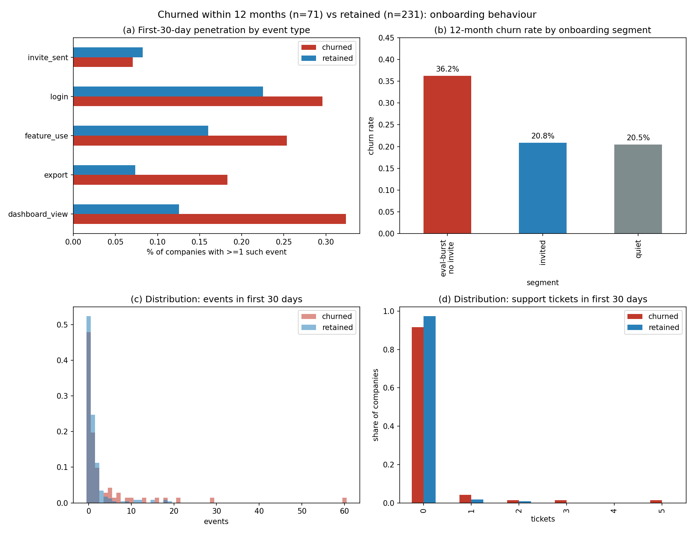

# Milestone 4B — Behavioural predictors: evaluation without embedding

## The most important predictor (M5 candidate)

**A company that evaluates hard but never invites anyone churns at 36% —
nearly double the 21% baseline.** Concretely: dashboard views or exports in
the first 30 days *with no `invite_sent`* → 36.2% churn within 12 months
(n=58), versus 20.8% for companies that invite a teammate (n=24) and 20.5%
for quiet ones (n=220). The playbook writes itself: trial activity without
collaboration is a tire-kicker flag, and the intervention is getting a second
seat in the room — not more feature tours. This is the finding to weigh
against M3's month-1 cliff in M5.

## Design (fixed-horizon onboarding)

302 paid companies with first subscription in 2024-02–2025-05 (full 30-day
event coverage, 12-month outcome observable for all): 71 churned within a
year vs 231 retained; 18 ambiguous horizon states excluded. A calendar
case-control window was rejected on evidence — most churners are young, so a
90-day exposure filter shrank the churned set to n=13 of only old churners.

## Signal 2: activity points the "wrong" way — and that's the insight

The naive hypothesis (more activity = stickier) fails inverted. Churned
companies are *more* instrumented-active in month one: 3.5 vs 1.4 events
(+153%), dashboard views 32% vs 13% (2.6×), exports 18% vs 7% (2.5×), feature
use 25% vs 16%. Mechanism: this is evaluation behavior — clicking through
dashboards, exporting trial data, deciding "not for us" — while retained
companies embed through channels this logging barely sees (half of *both*
groups log zero events in 30 days). Volume alone would mispredict; the
*composition* (evaluation without collaboration) is the signal.

## Signal 3: an early ticket is a friction flag (small-n caveat)

8.5% of churned companies file a support ticket in their first 30 days vs
2.6% of retained (3.3×; 0.18 vs 0.03 tickets per company). Ticket categories
split evenly (no single category drives it), and the base is thin — 6 vs 6
companies — so treat this as a corroborating flag for the at-risk list, not a
standalone trigger.

## Honest non-findings

Seats don't separate (0.25 vs 0.30 in 30 days — activation lags, not signal);
invites alone don't (7% vs 8% — too rare to carry a rule by themselves, which
is why the composite matters); burst-then-silence doesn't (week-1-active but
week-4-dark: 7% vs 8%). M2/M3 definitions reused throughout (paid, live,
churned); the company-grain churn counts here reconcile with M2's monthly
churns almost exactly.

## What would strengthen this

Post-onboarding heartbeat metrics (login recency in months 2–3), seat
expansion, and any in-product survey or NPS — plus a holdout test of the
36%-rule on 2025-06+ cohorts before anyone wires it to a save-desk trigger.
Correlation here is strong and actionable, but the causal claim ("invites
*saves* accounts") still needs an experiment — the database already holds the
raw material (`saas.experiments` has 2025 trial-length and onboarding-checklist
trials with `experiment_assignments`), which a follow-up can join to churn
outcomes. Baseline note: 23.5% is the whole-population churn rate (71/302);
20.5% is the quiet-segment rate used as the comparison baseline.

